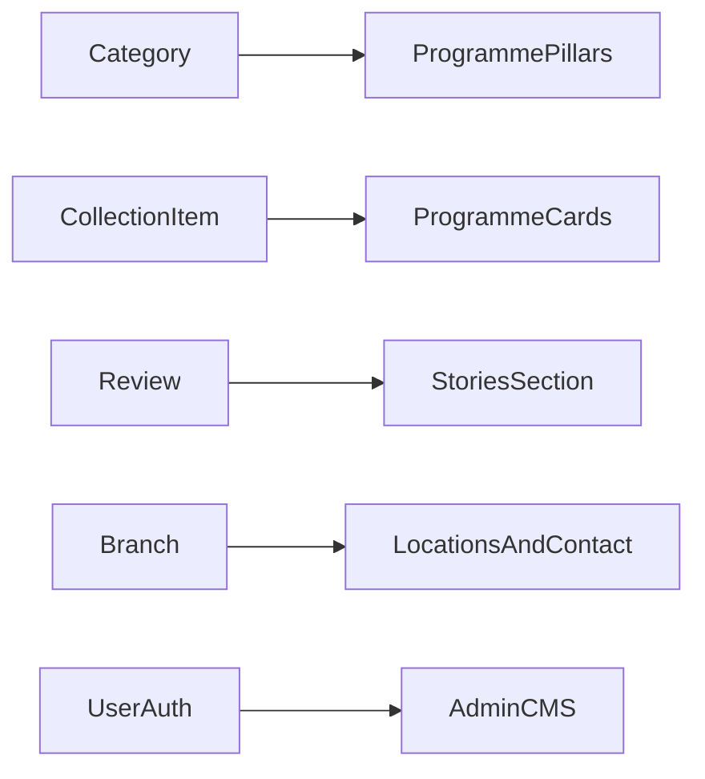
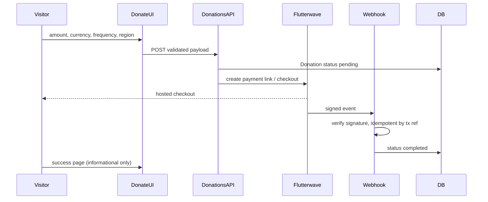

# Empowering the African Woman — full conversion plan

## Current baseline (what we keep)

| Layer | Today | Keep / change |
| --- | --- | --- |
| Framework | Next.js 15 App Router, Tailwind v4, TypeScript | Keep; align with blueprint folder additions |
| Auth | [lib/auth.ts](lib/auth.ts), NextAuth (Google + credentials), [middleware.ts](middleware.ts) guarding `/admin` | Keep behavior; update default admin email branding in env/docs only |
| Prisma auth | `User`, `Account`, `Session`, `VerificationToken` in [prisma/schema.prisma](prisma/schema.prisma) | Unchanged |
| Content DB | `Category`, `CollectionItem`, `Branch`, `Review` | **No table renames**; repurpose in UI and admin copy |
| Media | Google Drive / Supabase via [lib/google-drive.ts](lib/google-drive.ts), [app/api/images/[fileId]/route.ts](app/api/images/[fileId]/route.ts) | Keep for admin-uploaded programme and story images |
| Admin CRUD | [app/admin/categories](app/admin/categories), [app/admin/collections](app/admin/collections), API routes under `app/api/admin/` | Keep routes; relabel UI (“Programme categories”, “Programmes”) and hide `price` on public programme cards (field can remain optional in DB) |

## Semantic mapping (boutique → charity)



- **Homepage** composes blueprint sections from DB + static config (mission copy, impact *targets* clearly labeled until verified).
- **Reviews** page becomes **Stories** (`/stories`, redirect from `/reviews`).
- **Collections** becomes **Programmes** (`/programmes`, redirect from `/collections`).
- **Locations** stays for offices / programme hubs (`Branch`).
- Retire or redirect boutique-only routes: [app/(default)/flagship/page.tsx](app/(default)/flagship/page.tsx) → `/about` or `/locations`.

## Target architecture (blueprint-aligned)

Add configuration and presentation layers without duplicating sites:

```
config/          brand.ts, regions.ts, navigation.ts
content/         africa.ts, canada.ts, us.ts, global.ts
components/
  layout/        SiteHeader, SiteFooter, MobileMenu, RegionSelector
  home/          HeroSection, AboutSection, ProgrammePillars, ImpactSection, StoriesSection, DonationSection
  donation/      DonationForm, AmountSelector, FrequencySelector
lib/
  payments/      flutterwave.ts, validation.ts
  region/        cookies.ts (site-region, 180 days)
app/
  page.tsx       marketing entry (may delegate to regional default)
  africa|canada|us|global/page.tsx
  about|programmes|impact|stories|donate/...
  api/donations/route.ts + webhook route
netlify/
  edge-functions/region.ts
netlify.toml
AGENTS.md
```

Public shell: replace root [components/ui/header.tsx](components/ui/header.tsx) / [components/ui/footer.tsx](components/ui/footer.tsx) with blueprint layout components (or refactor existing files in place to avoid duplicate headers). [app/layout.tsx](app/layout.tsx) switches fonts from Cormorant/Montserrat/Great Vibes to **Playfair Display + Inter** and updates site metadata.

## Phase A — Design system and engineering rules

1. **Tokens** in [app/css/style.css](app/css/style.css) and [app/css/additional-styles/theme.css](app/css/additional-styles/theme.css):
   - Cocoa `#542719`, gold `#DCA126`, orange `#B94E25`, ivory `#F5E8D5`, page white `#FBF9F5`
   - Utility classes: `.container`, `.eyebrow`, `.button-primary` / `.button-secondary`, `.card-programme`, image radii/shadows per blueprint
2. **Dependencies**: add `lucide-react`; add test stack from blueprint (`vitest`, `@testing-library/react`, `@playwright/test`) and minimal scripts in [package.json](package.json)
3. **AGENTS.md** at repo root (content from blueprint §6) for consistent agent/human rules
4. **Rename project metadata**: `package.json` name, README, `.env.example` placeholders (charity admin email, Flutterwave keys)—no secrets committed

## Phase B — Public site (visual + engaging UX)

Build the homepage as **composable server components** (blueprint §5), wired to real data where possible:

| Section | Data source |
| --- | --- |
| Hero | Regional `content/*.ts` + static hero image in `public/images/` |
| About / mission | [lib/content/about.ts](lib/content/about.ts) rewritten for charity |
| Programme pillars | Four items from config **or** top four `Category` rows |
| Impact | Static config only; every figure labeled **target** until org verifies |
| Programmes + cards | `getFeaturedCollections()` / categories from [lib/queries.ts](lib/queries.ts) |
| Stories | `getPublishedReviews()` (consent note in admin copy) |
| Donation panel | Client form → API (Phase C); currency from region config |
| Footer | Governance links, social placeholders, contact from config |

**Engagement (modern, restrained):** keep scroll reveal via existing AOS in [app/(default)/layout.tsx](app/(default)/layout.tsx); add Lucide icons on pillars/cards; optional subtle CSS transitions on cards (no heavy animation libraries). Replace monolithic [components/single.tsx](components/single.tsx) with a thin page that imports section components.

**Supporting pages:** implement `/about`, `/programmes`, `/impact`, `/stories`, `/donate`, `/donate/success` with shared layout and charity copy. Update [lib/queries.ts](lib/queries.ts) only where needed (e.g. programme-focused ordering, no price in return shape for public DTOs if desired).

## Phase C — Regional experience + Netlify edge

Per blueprint §8:

| Route | Default currency (UI) |
| --- | --- |
| `/africa` | NGN |
| `/canada` | CAD |
| `/us` | USD |
| `/global` | USD |

1. [config/regions.ts](config/regions.ts) + [content/africa.ts](content/africa.ts) etc. drive copy, currency, contact CTAs
2. `RegionSelector` sets `site-region` cookie (180 days); all regional pages remain directly linkable
3. Add [netlify/edge-functions/region.ts](netlify/edge-functions/region.ts) + [netlify.toml](netlify.toml): on **first visit to `/` only**, redirect using Netlify country context **unless** cookie or query override; never redirect deep links
4. Document local dev: edge function behavior may differ on `next dev`; use Netlify CLI or manual `/africa` etc. for QA

## Phase D — Donations (Flutterwave, server-trusted)



1. **Schema extension** (additive migration only—preserves existing tables):

```prisma
model Donation {
  id            String   @id @default(cuid())
  amount        Decimal  @db.Decimal(10, 2)
  currency      String
  frequency     String   // one_time | monthly (as supported)
  region        String?
  campaign      String?
  status        String   // pending | completed | failed
  provider      String   @default("flutterwave")
  providerRef   String?  @unique
  donorEmail    String?
  donorName     String?
  metadata      Json?
  createdAt     DateTime @default(now())
  updatedAt     DateTime @updatedAt
}
```

2. **`POST /api/donations`**: Zod validate amount/currency/frequency/region; **never trust client totals** beyond allowed presets + custom min/max; create pending `Donation`; call Flutterwave to obtain checkout URL; return redirect URL
3. **`POST /api/donations/webhook`** (or Flutterwave-specific path): verify secret/hash per Flutterwave docs; upsert by `providerRef`; ignore duplicates
4. **`/donate/success`**: thank-you UI only—success state comes from webhook + optional polling by reference, not from query params alone
5. **Env** (document in `.env.example`): `FLUTTERWAVE_SECRET_KEY`, `FLUTTERWAVE_PUBLIC_KEY`, `FLUTTERWAVE_WEBHOOK_SECRET`, public site URL for callbacks

**Admin (minimal v1):** optional read-only donations list under `/admin` later; not required for launch if webhook + DB logging suffice.

## Phase E — Admin, seed, and cleanup

1. Update [prisma/seed.ts](prisma/seed.ts) with charity programme categories, sample programmes, branches (offices), and stories—replace Viv La Viv copy
2. Relabel admin dashboard [app/admin/page.tsx](app/admin/page.tsx) and nav [components/admin/admin-nav.tsx](components/admin/admin-nav.tsx); adjust forms ([components/admin/collection-form.tsx](components/admin/collection-form.tsx)) to de-emphasize price
3. Remove or leave unused Cruip components (`hero-home`, `workflows`, etc.)—delete only if unreferenced after migration to reduce noise
4. **WhatsApp** floating button: retarget to charity contact number from config (keep component if useful for African audience)

## Phase F — Quality, deploy, launch checklist

Align with blueprint §10:

- `pnpm lint`, `pnpm build`, typecheck
- Playwright: header nav, mobile menu, donate form → API mock or test keys
- Vitest: donation validation, region cookie helper, webhook idempotency unit tests
- Accessibility pass on header, forms, focus order
- Netlify: connect repo, set env vars, confirm Next.js adapter settings for App Router + edge functions
- **Do not enable live donations** until Flutterwave test transactions, webhook verification, and privacy/receipt copy are signed off

## Risk and dependency notes

- **Flutterwave recurring**: confirm org account supports subscription/recurring for “monthly” frequency; if not, ship one-time first and gate monthly in UI
- **NGN vs CAD/USD settlement**: regional defaults are presentation; checkout must use currencies enabled on the org account
- **Impact numbers and testimonials**: never present seed/review content as verified impact; use “target” labels and org-approved copy only
- **Images**: replace boutique assets under `public/images/` with licensed charity photography when available; keep obvious placeholders until then

## Suggested implementation order

1. Design tokens, fonts, AGENTS.md, config/content skeleton  
2. Layout components + homepage sections + page remaps/redirects  
3. Regional routes + cookie + Netlify edge  
4. Prisma `Donation` + Flutterwave API + webhook + donate pages  
5. Seed/admin relabel + tests + Netlify deploy validation  
